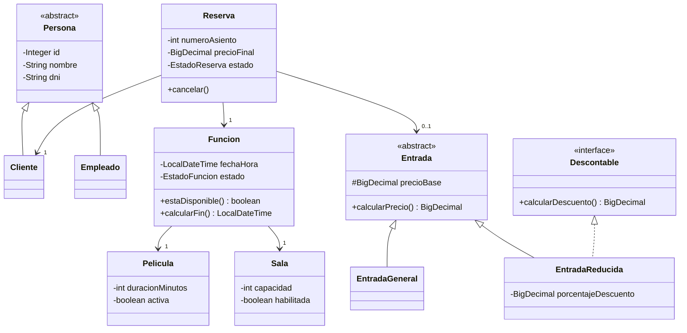
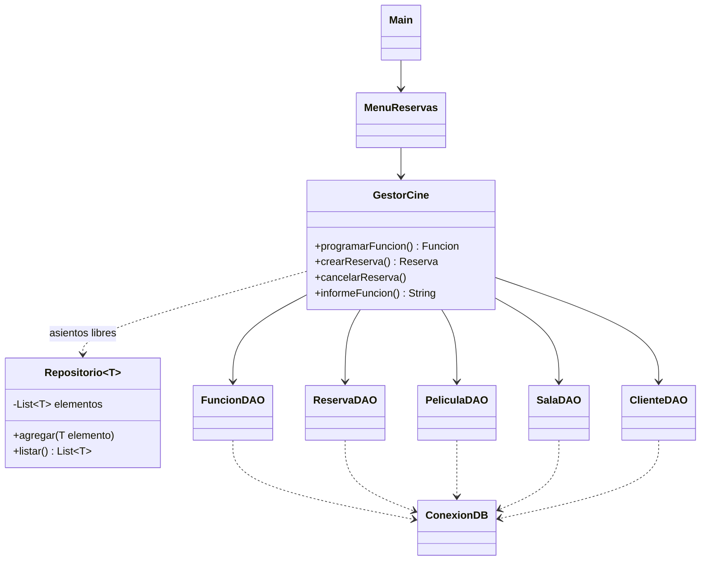

# UML de CineGestor

## Modelos

## Menú, gestor y persistencia

Al reservar, el gestor guarda una referencia de tipo `Entrada`. Java elige si usa el cálculo general o el reducido. La base conserva el tipo y el precio final de la reserva histórica.

`Repositorio<Integer>` reúne los números de asientos libres. Entre las excepciones que atiende el menú están `DatoInvalidoException`, `HorarioSuperpuestoException`, `AsientoOcupadoException` y `PersistenciaException`.

Al aplicar el parche de Lauti, `Main` también abre `MenuAdministracion`, que usa los DAO de películas, salas y clientes.
